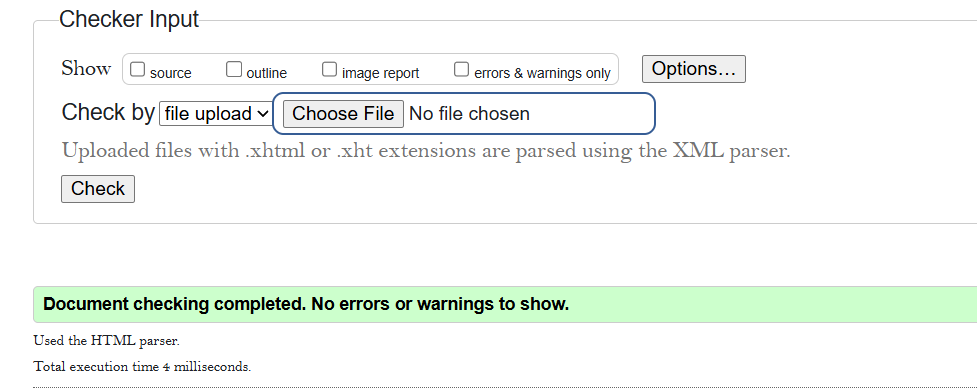

# learnify
Learnify is a lightweight online learning platform built with HTML, CSS, and vanilla JavaScript, featuring course navigation, learning progress tracking, localStorage persistence, and interactive quizzes.
## Validation (static pages, part 1)

The static pages were checked with the W3C validators.

| File | Validator | Result |
|---|---|---|
| index.html | W3C Markup Validation Service | No errors |
| course.html | W3C Markup Validation Service | No errors |
| style.css | W3C CSS Validation Service | No errors |

### W3C validation

